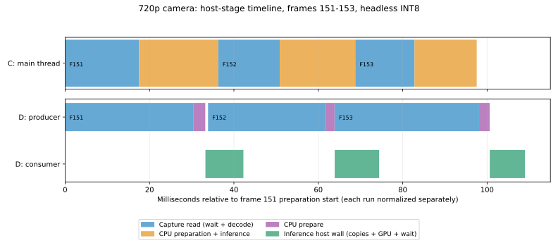

# 1280×720 真实摄像头：串行与双缓冲复测

日期：2026-10-22；正式测试北京时间 **15:24:10–15:31:07**，约 6 分 57 秒，12/12 次通过。

**结论：在用户实际的 720p、30 FPS、混合 INT8 单模型条件下，串行和双缓冲均约 30 FPS，本次没有观察到实质吞吐提升或完成帧龄改善。此前的 0.5～1.3 秒级停顿在本轮没有复现，但不能据此认定根因已解决或双缓冲消除了尾延迟。**

## 最新提交核对与本次范围

最新提交 `a2572fcc858dd1a48262cba2f7c022dae2bd8162` 新增公共模块重构 A/B/C 测试脚本和报告，没有改变推理实现。该报告的主测为 1080p；720p 仅补测了开启显示的一轮，且不含双缓冲。

历史 1080p 结果是对应分辨率下的实测，不是 720p 证据。尤其不能继续用此前无显示 +11.15%、开启显示 +19.69% 表示用户当前 720p 的收益。此前没有先对齐实际输入尺寸，是测试设计上的问题。

用户确认先执行约 7 分钟方案后，本轮仅重测 C/D、混合 INT8、无显示/显示各三轮，不把 A/B、FP16 短测或历史 1080p 数据混入正式统计。

| 标记 | 版本 | 入口 |
|---|---|---|
| C | `5b736f9f308fbb115f73c234b642aba4cafdcf85`，提取公共模块后、双缓冲前 | 串行 `edge_video` + YAML |
| D | `a2572fcc858dd1a48262cba2f7c022dae2bd8162` 的应用代码 | 双缓冲 `edge_video` + YAML |

两者使用相同的源帧显示画布，避免兼容 CLI 的 360×640 画布与配置入口原图显示混比。C 二进制哈希与前次报告 provenance 一致，源码已对照固定提交核验；D 为当前 Release 构建。两者 `cuda_pipeline.cpp`、`cuda_yolo.cu` SHA-256 一致，engine 测试前后哈希一致，没有重建模型。

## 条件和方法

- LRCP F1080P USB 摄像头，稳定路径 `/dev/v4l/by-id/usb-LRCP_F1080P_LRCP_F1080P_000000000001-video-index0`，当前对应 `/dev/video8`。
- **1280×720、MJPG、30 FPS、V4L2 两个采集缓冲**。每轮核验实际尺寸、源 FPS、缓冲数，并读取 V4L2 验证 MJPG。
- 同一 `trial007_sub_model22/yolov8m_int8.plan`，`input_stage: camera`，Graph=1。仅一个模型，无录像、无图像保存；显示使用真实桌面 DISPLAY=:1。
- MAXN，未修改功耗、时钟策略或曝光。保留 DVFS；没有锁频和完整后台负载控制。真实场景画面可能随时间变化，无法保证各轮输入像素完全相同。
- 每轮 900 帧，排除前 150 帧，保留其余 750 帧及全部异常值。总处理 10800 帧，统计 9000 帧和 8988 个同轮相邻完成间隔。
- 每场景三轮，按 C/D 与 D/C 交替；两种场景在轮次内穿插。三个配对无法在每个场景内完全平衡先后位置，实际顺序保存在 schedule.json。
- 每轮 FPS = `(750−1)×1000/(末帧 end_ms−首个保留帧 end_ms)`；表中吞吐为三轮算术平均。P95/P99 为同场景同版本合并帧或间隔后的线性插值百分位，不用最快轮替代均值。
- 完成帧龄 = 主机单调时钟 − V4L2 帧时间戳。全部保留帧均有效，时间戳严格递增，但这不证明没有设备丢帧；该值也不是曝光到屏幕实测延迟。

## 稳态吞吐

| 场景 | C 串行 FPS | D 双缓冲 FPS | D/C 观测差值 | C 三轮范围 | D 三轮范围 |
|---|---:|---:|---:|---:|---:|
| 无显示 | 29.979 | 29.949 | -0.100% | 29.925–30.012 | 29.920–30.005 |
| 开启显示 | 29.983 | 29.979 | -0.014% | 29.928–30.022 | 29.926–30.008 |

这两个微小差值不足以证明加速或回退；两个版本均接近 30 FPS 源帧率上限。当前负载下串行版已足够及时消费相机，双缓冲不能让 30 FPS 摄像头产生更多帧。

## 尾延迟是否仍出现

这里先看相邻处理完成间隔，用它判断“画面处理是否长时间停住”，再单独看帧龄。

| 场景 | 版本 | 完成间隔 P95 ms | P99 ms | 最大 ms | >50 ms 次数 | >100 ms 次数 |
|---|---|---:|---:|---:|---:|---:|
| 无显示 | C | 39.191 | 42.385 | 67.999 | 3 | 0 |
| 无显示 | D | 38.972 | 41.730 | 82.289 | 7 | 0 |
| 开启显示 | C | 39.435 | 41.775 | 68.803 | 4 | 0 |
| 开启显示 | D | 39.499 | 42.934 | 75.653 | 9 | 0 |

**没有复现之前 0.5 秒以上的停顿，但仍有 50～82 ms 的抖动，双缓冲最大间隔并未更小。** 本轮不含日志屏蔽、异步日志、锁频或其他针对长尾的修复，所以不能把“本次没发生”解释成“已修好”。

历史长停顿在串行与双缓冲路径都出现过，并多发生在每 30 帧日志之后；这只是待验证的相关性。没有此次复现及精确区间/系统调用追踪，不能断言是磁盘 flush、调度、GUI 或 CUDA 导致。本次按约 7 分钟范围完成测试，没有追加长期诊断或无依据修改推理代码。若后续重现，优先对帧末 bookkeeping、日志输出、槽位释放分别打点，并记录主线程调度/写调用；它们在现有 CSV 的阶段覆盖之外或仅表现为 queue_wait。

| 场景 | 版本 | 完成帧龄均值 ms | P95 ms | P99 ms | 最大 ms |
|---|---|---:|---:|---:|---:|
| 无显示 | C | 56.072 | 61.561 | 63.941 | 83.908 |
| 无显示 | D | 56.926 | 62.291 | 65.073 | 93.202 |
| 开启显示 | C | 57.996 | 63.344 | 67.258 | 103.623 |
| 开启显示 | D | 59.528 | 65.106 | 68.684 | 98.090 |

D 的平均完成帧龄本次略高（无显示约 +0.85 ms，显示约 +1.53 ms），没有实测到延迟收益。最大帧龄与最大完成间隔是不同指标，例如串行显示最大帧龄可略超 100 ms，但相邻完成间隔仍未超过 100 ms。

## 双缓冲具体优化了什么

它改变的是调度依赖，不减少单帧计算量，也没有换更快的 TensorRT engine：

```text
串行主线程：读取 N → CPU 准备 N → GPU 推理/等待 N → 显示 N → 读取 N+1

双缓冲准备线程：读取 N+1（等待/解码）→ CPU 准备 N+1
双缓冲消费线程：GPU 推理/等待 N     → 显示 N
```

理想供帧充分时，帧间隔可由两段时间之和接近两段时间的较大值；真实摄像头还存在 `1000/30≈33.3 ms` 的供帧周期约束。这里读取时间包含等待下一帧，不是纯解码 CPU 时间，不能用它直接推算脱离相机限速后的理论 FPS。

### 对齐统计边界后的分项均值

单位 ms。C 的 pipeline 已包含 CPU 准备；D 的 prepare 是移出的 CPU 几何处理，pipeline 包含传输、GPU 计算、同步和结果封装，仍不是纯 kernel 时间。

| 场景 | 版本 | 读取 | CPU prepare 单列 | pipeline | 可比处理总和 | 绘制+显示 |
|---|---|---:|---:|---:|---:|---:|
| 无显示 | C | 19.132 | 含在 pipeline | 14.211 | 14.211 | 0.000 |
| 无显示 | D | 30.845 | 2.513 | 12.449 | 14.962 | 0.000 |
| 开启显示 | C | 16.325 | 含在 pipeline | 13.681 | 13.682 | 3.318 |
| 开启显示 | D | 30.889 | 2.405 | 11.185 | 13.590 | 3.699 |

可比处理总和为 `geometry_ms + prepare_ms（旧版为0）+ pipeline_ms`。不能把 D 的 pipeline 从约 14 ms 变成约 11～12 ms 当成同等幅度的 GPU 加速：约 2.4～2.5 ms 的 CPU 准备只是换了统计列。无显示的可比总和 D 甚至较高，显示两者相近；没有固定频率和相同像素输入，不能将小差异单独归因于某个实现开销。

双缓冲的主机区间确实交叠：D 相邻帧 start/end 重叠率为 100%，C 为 0%。根据 CSV 阶段时长反推边界，D 无显示时“下一帧读取”与“当前 infer”平均重叠约 12.44 ms；显示时约 11.16 ms。相反，“下一帧 CPU prepare”与“当前 infer”平均重叠接近 0 ms。这说明**本次主要隐藏的是采集读取中的等待/解码过程，而不是每帧都在同时执行 CPU 转置和 GPU kernel**。读取内部等待和解码未单独打点，不能进一步精确分摊；这些也是主机时长近似重建，不是 CUDA kernel trace。



图取第一轮无显示的固定帧 151～153，各自以帧 151 开始准备为零点；由已有 CSV 阶段时长近似重建，细小阶段间 bookkeeping 未单列。图中 infer 为 host wall time。

### 为什么总耗时可能更长，FPS 却相同

D 的 `total_ms` 从准备线程更早开始读这一帧算起，而 C 从主线程开始处理这一帧算起。D 可以一帧尚未完成时就开始下一帧，因此多个 total 区间重叠，且一个区间可大于 33.3 ms。不能用 `1000/mean(total_ms)` 计算吞吐，也不能据此认定摄像头延迟增加了同样数量；帧龄应看相同采集时间戳基准。

**对当前 720p 单模型使用方式，双缓冲不是已验证的 FPS/延迟优化。它提供了阶段交叠能力；只有当 CPU 准备与消费的串行总时间成为瓶颈时，才可能转化为吞吐收益，仍需在该负载下实测。** 本次没有压力注入或无限供帧测试，不以此宣称具体额外处理余量。

## 代码、复现与证据

- `configs/yolo-video.yaml` 已修正为 1280×720，其余无显示、INT8、Graph、30 FPS、两个缓冲设置保持一致。
- benchmark 脚本新增可选 D 和 `--comparison double`，保留原 A/B/C 工作流；analysis 新增 P99、可比处理总和、排队/长尾区间及 >50 ms 计数，并有独立回归测试。
- 未修改 GPU 算法或流水线实现，没有为得到好看的数字删除异常帧或替换测试轮次。

```bash
python3 scripts/benchmark_camera_architecture.py \
  --output outputs/camera-720p-double-new-run \
  --build-before cache/camera-architecture-5b736f9-20261022/build-before \
  --build-after cache/camera-architecture-5b736f9-20261022/build-after \
  --build-double build-shared \
  --double-commit a2572fcc858dd1a48262cba2f7c022dae2bd8162 \
  --comparison double --width 1280 --height 720 \
  --frames 900 --warmup 150 --rounds 3
python3 scripts/analyze_camera_architecture.py outputs/camera-720p-double-new-run
python3 scripts/test_camera_analysis.py
```

本轮保留的原始数据（outputs 按 Git 规则忽略）：

- [metadata.json](../../outputs/camera-720p-double-20261022/metadata.json)：设备、分辨率、时间、engine/binary SHA-256。
- [source-provenance.json](../../outputs/camera-720p-double-20261022/source-provenance.json)：基线源码核对及 CUDA 文件一致性。
- [schedule.json](../../outputs/camera-720p-double-20261022/schedule.json)、[runs.json](../../outputs/camera-720p-double-20261022/runs.json)：实际顺序、参数、返回码和 CSV 哈希。
- [summary.json](../../outputs/camera-720p-double-20261022/summary.json)：完整均值、P95/P99、最大值和逐轮结果。
- [stage-overlap-estimates.json](../../outputs/camera-720p-double-20261022/stage-overlap-estimates.json)：阶段重叠近似估计。
- 同目录每轮 `.csv`、`.yaml`、`.log`、`.tegrastats.log` 和脚本快照均保留。

GPU 温度在本轮约 40°C，明显低于此前部分 1080p 测试的环境；因此不能通过跨轮历史比较将全部差异精确归因于像素数。应以本轮同分辨率交叉 C/D 对照回答双缓冲的实际收益。三轮和约七分钟的窗口仍不足以证明长期无偶发停顿。
