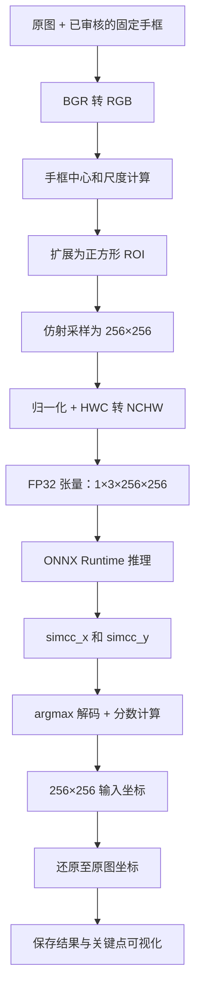

<!-- 本文解释 Reference Freeze 的实际流程、操作原理与代码出处，整理自项目问答。 -->

# RTMPose-Hand Reference Freeze 流程与原理详解

本步骤建立了一套可信、可复现的 Python ONNX Runtime FP32 参考流程，并冻结输入、预处理和输出解码规则。后续实现 TensorRT FP32、FP16、INT8 时，都以这套流程作为对照。

本次关键点可视化已通过用户人工评审，结果保存在[核验报告](../configs/rtmpose_hand_reference.verification.json)。技术契约见[冻结配置](../configs/rtmpose_hand_reference.json)，执行结果与复现方法见[核验记录](reference-freeze.md)。

本文中的仓库代码链接使用相对路径和 `#L行号`，便于在代码托管页面查看；普通 Markdown 阅读器可能只打开文件，不定位行号。rtmlib 源码位于本机 Python 环境中，链接为本机绝对路径；其他机器应按相同包版本和配置中的源码哈希查找。

## 整体流程



## 1. 确认模型要求的输入

仅知道输入形状是 `[1,3,256,256]` 不够，还需要确认：

- 三个通道是 RGB 还是 BGR。
- 像素是否需要除以 255。
- mean/std 的数值及通道顺序。
- 模型图是否已经包含预处理。

本次最重要的发现是：**旧张量的颜色顺序需要修正。**

官方模型包中的 ONNX 与本地模型 SHA-256 完全一致。同包预处理元数据明确要求转 RGB，版本化训练配置也有对应设置；本地 ONNX 输入直接进入卷积，没有内置换通道或归一化。来源链接、元数据冲突处理和哈希详见[核验记录中的颜色依据](reference-freeze.md#颜色依据与数据修正)。

但是，本地 rtmlib 的 `RTMPose.preprocess()` 没有自动执行 BGR→RGB，旧流程又直接传入 OpenCV 读取的 BGR 图像，因此需要在调用前显式转换。

代码出处：

- [官方来源、元数据和模型哈希核验：verify_reference_config.py，第 190 行](../scripts/verify_reference_config.py#L190)。
- [显式 BGR→RGB 转换：verify_reference_config.py，第 346 行](../scripts/verify_reference_config.py#L346)。
- [本地 rtmlib 预处理实现：rtmpose.py，第 45 行](/home/ssd/anaconda3/envs/py38/lib/python3.8/site-packages/rtmlib/tools/pose_estimation/rtmpose.py#L45)。

卷积权重已经学习了各输入通道的作用。交换红蓝通道会改变输入与权重之间的对应关系；图像尺寸正确、模型能够运行，并不代表颜色语义正确。本次依据模型来源确定 RGB，没有用“哪边置信度高”来选择。

## 2. 把手框变成统一的模型观察区域

RTMPose-Hand 使用 top-down 流程：先给出一只手的位置，再对这只手估计关键点。本次直接复用已审核的手框，没有重新运行检测器改变框。

原始框为：

```text
[x1, y1, x2, y2]
```

先计算中心：

```text
cx = (x1 + x2) / 2
cy = (y1 + y2) / 2
```

宽高为：

```text
w = x2 - x1
h = y2 - y1
```

由于输入是正方形，最终观察区域的边长为：

```text
s = 1.25 × max(w, h)
```

这里的 `scale` 是**原图中扩展区域的宽高，单位是像素**，不是直接表示缩放倍率的无量纲数。

例如一个宽 80、高 100 像素的手框，最终变成中心不变、边长 125 像素的正方形区域。这样既留出一定上下文，也避免把长方形手部区域直接拉伸变形。

代码出处：

- [手框转 center/scale：pre_processings.py，第 7 行](/home/ssd/anaconda3/envs/py38/lib/python3.8/site-packages/rtmlib/tools/pose_estimation/pre_processings.py#L7)。
- [按模型输入宽高比调整 scale：pre_processings.py，第 144 行](/home/ssd/anaconda3/envs/py38/lib/python3.8/site-packages/rtmlib/tools/pose_estimation/pre_processings.py#L144)。

## 3. 用 affine 把区域采样到 256×256

有了中心和尺度，下一步建立原图到输入图的仿射变换。

本次没有旋转，因此它主要完成平移和等比例缩放。可以用下面的关系理解：

```text
u = (x - (cx - s / 2)) / s × 256
```

```text
v = (y - (cy - s / 2)) / s × 256
```

其中：

- `(x, y)`：原图坐标。
- `(u, v)`：模型输入图坐标。
- `(cx - s / 2, cy - s / 2)`：扩展区域的左上角。

实际实现使用 `cv2.getAffineTransform()` 生成矩阵，再使用 `cv2.warpAffine()` 采样。

采用双线性插值，是因为目标像素映射回原图后通常落在非整数位置，需要根据附近像素计算颜色。观察区域超出原图的部分填 0。

**零填充发生在归一化之前。** 填充像素归一化之后会变成 `-mean/std`，不会仍然是数值 0。

代码出处：

- [仿射矩阵构造：pre_processings.py，第 75 行](/home/ssd/anaconda3/envs/py38/lib/python3.8/site-packages/rtmlib/tools/pose_estimation/pre_processings.py#L75)。
- [warpAffine 采样：pre_processings.py，第 160 行](/home/ssd/anaconda3/envs/py38/lib/python3.8/site-packages/rtmlib/tools/pose_estimation/pre_processings.py#L160)。

## 4. 把图像变成模型张量

仿射得到的是一张 `256×256×3` 的 RGB 图像，接着逐通道归一化：

```text
tensor[c] = (pixel[c] - mean[c]) / std[c]
```

其中 `c` 表示 RGB 中的一个通道。对应参数：

```text
mean = [123.675, 116.28, 103.53]
std  = [58.395, 57.12, 57.375]
```

这些参数直接匹配 0～255 的像素尺度，因此**不能再额外除以 255**。

随后调整内存布局：

```text
HWC：256×256×3
 ↓ transpose
CHW：3×256×256
 ↓ 增加 batch 维度
NCHW：1×3×256×256
 ↓
连续内存、FP32
```

“连续内存”保证数组按照确定的顺序存放，方便后续直接传给推理引擎。这里还锁定了本地参考实现的数值行为：归一化中间计算使用 float64，最后转换为 FP32。

代码出处：

- [rtmlib 中的归一化：rtmpose.py，第 67 行](/home/ssd/anaconda3/envs/py38/lib/python3.8/site-packages/rtmlib/tools/pose_estimation/rtmpose.py#L67)。
- [HWC→NCHW、连续 FP32 转换：verify_reference_config.py，第 55 行](../scripts/verify_reference_config.py#L55)。

这也是为什么现在的 `.npy` 可以直接进入模型：**它保存的是处理完成的输入张量，不是等待进一步处理的图片。**

## 5. 为什么重建 407 个张量，却不用重新审核裁剪

改变的是颜色通道对应关系，手框和几何区域没有改变。

我们检查了两条独立生成路径：

```text
路径 A：
原图 → RGB → 按固定 bbox 仿射 → 归一化 → 张量

路径 B：
已保存的裁剪 PNG → RGB → 归一化 → 张量
```

407 个样本的两条路径结果逐元素相等。这证明现有裁剪内容可以继续使用，随后从裁剪重建了：

- 352 个 calibration 张量。
- 55 个 development 张量。

旧张量与元数据先备份，再生成候选文件并替换现用文件；手框、裁剪、划分和两份顺序表保持不变。张量内容变了，所以清单中的张量 SHA-256 和 coverage 的相关追溯信息也随之更新。

代码出处：

- [两条预处理路径的逐元素比较：verify_reference_config.py，第 350 行](../scripts/verify_reference_config.py#L350)。
- [备份和张量重建流程：rebuild_reference_tensors.py，第 11 行](../scripts/rebuild_reference_tensors.py#L11)。
- [候选文件生成与替换：rebuild_reference_tensors.py，第 71 行](../scripts/rebuild_reference_tensors.py#L71)。

## 6. 模型输出的 SimCC 是什么

模型输出两个张量：

```text
simcc_x：[N,21,512]
simcc_y：[N,21,512]
```

含义如下：

- `N`：这一批有多少只手。
- `21`：每只手的 21 个关键点。
- `512`：每个坐标轴上的候选位置数量。

对于某个关键点，模型分别给出：

```text
X 方向：512 个位置的响应
Y 方向：512 个位置的响应
```

然后在每个方向选响应最大的索引：

```text
ix = argmax(simcc_x)
iy = argmax(simcc_y)
```

由于 split ratio 是 2：

```text
u = ix / 2
v = iy / 2
```

例如峰值索引是 `(240,300)`，解码后的输入图坐标就是 `(120,150)`。

这意味着当前 argmax 解码的坐标步长是输入图上的 0.5 像素；它不意味着模型实际误差只有 0.5 像素。

代码出处：

- [ORT 读取两个具名输出：verify_reference_config.py，第 427 行](../scripts/verify_reference_config.py#L427)。
- [argmax 和峰值计算：post_processings.py，第 72 行](/home/ssd/anaconda3/envs/py38/lib/python3.8/site-packages/rtmlib/tools/pose_estimation/post_processings.py#L72)。
- [除以 split ratio：verify_reference_config.py，第 440 行](../scripts/verify_reference_config.py#L440)。

本次保持原参考行为，不额外加 softmax 或坐标细化操作。

## 7. 关键点分数与无效点如何处理

本地参考实现的分数是两个方向峰值的平均：

```text
score = (max(simcc_x) + max(simcc_y)) / 2
```

例如 X 峰值 0.8，Y 峰值 0.2，最终分数是 0.5。这里的分数不应直接解释成“正确概率为 50%”。

还有一个容易踩坑的细节：

```text
score ≤ 0
 ↓
SimCC 坐标设为 (-1,-1)
 ↓ 除以 2
输入图坐标变为 (-0.5,-0.5)
 ↓ 还原至原图
结果通常不再是 (-1,-1)
```

所以后续代码必须根据 `valid_mask = score > 0` 判断有效性，不能检查原图坐标是否等于 `-1`。

本次专门构造了平均分、并列最大值、零分和负分样例进行检查，避免只用真实图片时遗漏这些边界行为。并列最大值按照 `argmax` 的规则取第一个索引。

代码出处：

- [平均分和无效点规则：post_processings.py，第 98 行](/home/ssd/anaconda3/envs/py38/lib/python3.8/site-packages/rtmlib/tools/pose_estimation/post_processings.py#L98)。
- [构造数据验证解码规则：verify_reference_config.py，第 124 行](../scripts/verify_reference_config.py#L124)。

## 8. 把关键点还原到原图

模型输出坐标处于 256×256 输入空间，需要转换回原始图片：

```text
x = (u / 256) × s + cx - s / 2
```

```text
y = (v / 256) × s + cy - s / 2
```

这与前面的几何变换方向相反。

例如，扩展区域中心为 `(200,150)`、边长为 100，模型输入坐标为 `(128,128)`，它位于输入图正中心，因此还原后就是原图中心 `(200,150)`。

本次用了两种方式交叉核验：

1. rtmlib 的 center/scale 还原公式。
2. 清单中保存的逆仿射矩阵。

最大绝对坐标分量差约为 `0.000039` 像素，说明两种几何实现一致。**这个数是坐标变换之间的差异，不是关键点相对真实位置的预测误差。**

代码出处：

- [rtmlib 原图坐标还原：rtmpose.py，第 94 行](/home/ssd/anaconda3/envs/py38/lib/python3.8/site-packages/rtmlib/tools/pose_estimation/rtmpose.py#L94)。
- [独立公式和逆仿射交叉检查：verify_reference_config.py，第 453 行](../scripts/verify_reference_config.py#L453)。

## 9. 自动核验与人工评审分别解决什么问题

| 检查 | 本次范围 | 说明的问题 |
| --- | --- | --- |
| 模型、源码和元数据哈希 | 当前模型与参考实现 | 使用的是哪一版模型和算法 |
| 预处理逐元素比较 | 全部 407 个样本 | 已保存输入是否符合冻结规则 |
| ORT 推理与解码 | 全部 55 个开发样本 | 真实输入能否完整跑通，输出是否有限 |
| batch 对照 | 前 N 个开发样本，N=1/2/3/4 | 本环境中批量执行是否与逐个执行一致 |
| 几何交叉检查 | 55 个开发样本 | 输入坐标能否正确映射回原图 |
| 可视化人工评审 | 10 个代表样本页面 | 是否出现明显镜像、整体偏移或异常姿态 |

batch 对照代码见 [verify_reference_config.py，第 574 行](../scripts/verify_reference_config.py#L574)，样本选择逻辑见[第 285 行](../scripts/verify_reference_config.py#L285)。本环境下，所测 ORT batch 1/2/3/4 的输出与对应逐个推理结果一致；这不是 TensorRT 动态 batch 验证。

本次开发集用于建立参考基线；352 个校准样本只进行了输入侧核验，没有在本步骤参与 pose 输出评估。最终 validation 的 258 张原图仍保持隔离。

用户人工评审补上了数值检查无法替代的视觉确认。由于尚未提供逐点人工 GT，目前仍不能据此计算 PCK/NME。

## 10. “冻结”最终意味着什么

[rtmpose_hand_reference.json](../configs/rtmpose_hand_reference.json) 固定了模型输入输出、颜色、归一化、几何、解码、无效点规则及参考源码哈希；[核验报告](../configs/rtmpose_hand_reference.verification.json) 记录了实际验证结果和已通过的人工评审。

后续 C++/TensorRT 实现必须复现这些行为。遇到差异时，可以分层定位：

```text
输入张量不同 → 查 C++ 预处理
输入相同但 SimCC 不同 → 查推理后端或精度变化
SimCC 相同但关键点不同 → 查解码
输入坐标相同但原图坐标不同 → 查坐标还原
```

这一步为后续 TensorRT 部署准备好的，正是这套可逐层比较的基准。
