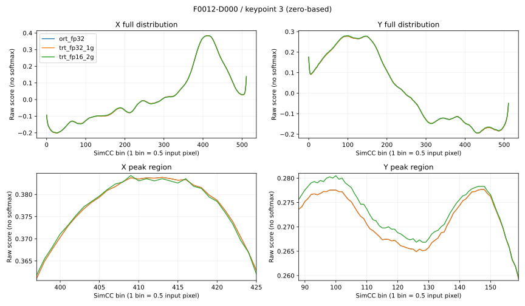

<!-- 本文只分析既有 FP16 raw 输出的峰切换，不改变精度策略或验收门槛。 -->
# SimCC 峰值与关键点偏移分析

当前状态仍为：FP16 两轮构建及开发集验证完成，精度验收未通过。
本次使用第二轮 2 GiB C++ builder 的 NPY batch=1 raw 输出，对比 ORT FP32 和历史 1 GiB TRT FP32。
不重建 engine，不修改 reference、ONNX 或门槛，不使用最终 validation。

## 结论

最大偏移已定位为 **F0012-D000、keypoint_id=3（从 0 编号）**，输入空间 L2 偏移 23.58495 px。
X 轴移动 −4 bins / −2 px，Y 轴移动 −47 bins / −23.5 px。
这个样本的近似等高峰在 FP16 下交换了高低顺序，argmax 将小幅 raw 变化放大成远距离坐标跳变。
这是直接可见的输出端机制，不是敏感层或权重转换根因的定位结果。

55×21=1155 个关键点全部参与统计，无置信度过滤。对 ORT 和 TRT FP32 的计数均为：

| 项目 | 点数 |
| --- | ---: |
| 坐标发生变化 | 562 |
| 偏移 >2 px | 6 |
| 偏移 >5 px | 3 |
| 偏移 >10 px | 3 |

当前样本的全部关键点有效，raw argmax 的位移与冻结解码的位移一致。
不要将这些计数解释为真实 GT 精度退化，也不能据此放宽验收门槛。

## 最大偏移点的数值证据

| 项目 | X | Y |
| --- | ---: | ---: |
| ORT Top1 bin | 413 | 147 |
| ORT Top2 bin | 409 | 148 |
| ORT Top1−Top2 margin | 0.000094742 | 0.000018239 |
| FP16 Top1 bin | 409 | 100 |
| FP16 Top2 bin | 411 | 98 |
| FP16 Top1−Top2 margin | 0.000732422 | 0.000244141 |
| ORT 中旧赢家−新赢家分差 | 0.000094742 | 0.000134587 |
| FP16 中新赢家−旧赢家分差 | 0.000732422 | 0.002197266 |
| 该轴完整分布 max abs | 0.003345035 | 0.003137559 |

Y 轴的具体分数：

| bin | ORT FP32 | TRT FP16 |
| --- | ---: | ---: |
| 147（ORT 赢家） | 0.277690768 | 0.278320313 |
| 100（FP16 赢家） | 0.277556181 | 0.280517578 |

ORT 的 Top2 是邻近的 bin 148，而 FP16 跳到了远处 bin 100。
所以仅看 Top1/Top2 margin 不够，必须同时检查另一精度赢家所在 bin 的分数。
下面包含完整分布和峰值区域放大图；曲线未做 softmax 或平滑。



## 其他大偏移点

| sample_id | keypoint_id（从 0 编号） | L2 偏移 px | 主要变化 |
| --- | ---: | ---: | --- |
| F0012-D000 | 3 | 23.58495 | Y: 147→100，X: 413→409 |
| F0010-D001 | 4 | 19.5 | X: 268→229 |
| F0031-D000 | 0 | 18.00694 | Y: 0→36，X: 164→163 |
| F0010-D001 | 7 | 2.5 | X: 135→130 |
| F0008-D000 | 3 | 2.23607 | X: 299→303，Y: 140→138 |
| F0043-D001 | 1 | 2.06155 | X: 417→413，Y: 140→139 |

第三个大偏移点原 Y 轴赢家在边界 bin 0，应单独关注边界分布，不能把所有大偏移笼统描述为两个内部峰之间切换。
以上仍未定位误差最初产生于哪个算子；现有权重警告也不足以证明某个权重或层造成这些跳变。

## 文件与复现

- [分析脚本](../scripts/analyze_simcc_margin.py)：按分数降序、bin 升序稳定取 Top1/Top2，符合并列 argmax 取首个索引规则。
- [测试](../tests/test_simcc_margin.py)：覆盖远峰切换、并列峰和非有限值拒绝。
- [结果摘要](../benchmarks/simcc-margin.json)：两种 FP32 对照、Top20 偏移点、每轴 margin 和输入证据 SHA。
- `validation/simcc-margin/all-keypoint-axis-margins.csv`：4620 行，覆盖 2 个对照×55 只手×21 点×2 轴。
- `validation/simcc-margin/worst-curves.json`：最差点三种精度的完整 512-bin 分布。
- `validation/trt-fp16-cpp-2g/layers-context.json` 与 `build.log`：既有 Inspector 和完整构建日志，保持原样。

```bash
/home/ssd/anaconda3/envs/py38/bin/python tensorrt-rtmpose-hand/scripts/analyze_simcc_margin.py
/home/ssd/anaconda3/envs/py38/bin/python -m unittest discover -s tensorrt-rtmpose-hand/tests -p 'test_simcc_margin.py'
```

分析前核验冻结资产、engine 构建完成记录、样本清单和 raw 输出哈希。
本次只完成输出端数值定位；相同 C++ builder/2 GiB 的新 FP32 对照，以及逐组 FP32 fallback，均尚未执行。
