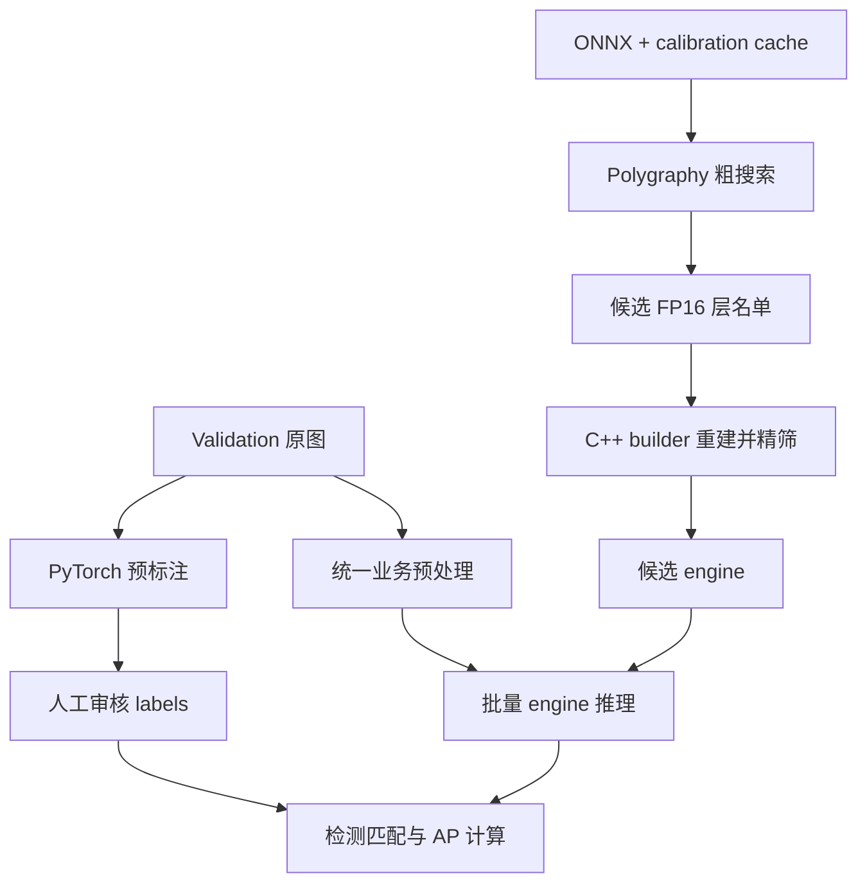

# 精度搜索、人工标注与验证：代码阅读指南

这组文档对应最近四个提交引入或修改的功能，面向希望理解实现而不只是运行命令的读者。

| 提交 | 主要内容 | 阅读入口 |
|---|---|---|
| `c882cab` | 通用精度 builder、Polygraphy 搜索、C++ 精筛及测试 | [精度搜索实现](PRECISION_IMPLEMENTATION.md) |
| `eed1c5c` | 原始 PyTorch 模型预标注及人工审核包 | [标注实现](ANNOTATION_IMPLEMENTATION.md) |
| `040f922` | 固定本次验证使用的标签及审核状态 | [验证实现](VALIDATION_IMPLEMENTATION.md#3-为什么需要标签快照) |
| `b271ce7` | 批量 engine 推理、评估指标和正式实验结果 | [验证实现](VALIDATION_IMPLEMENTATION.md) |

## 1. 先区分三种不同问题

1. **精度搜索**回答“哪些层需要保留 FP16，才能接近固定参考输出？”这里是单张图片、模型输出之间的比较。
2. **人工标注**回答“图片中需要评估的真实人物在哪里？”模型只能提供初始候选框，人来确认最终标签。
3. **Validation**回答“在已审核的数据集上，engine 的预测与人工标签有多一致？”这里才计算 Precision、Recall 和 AP。

不能把单图 PASS 当作数据集精度，也不能把预标注直接当作未经审核的 ground truth。

## 2. 推荐阅读顺序

- 先看 `include/precision_options.hpp`：理解 builder 的参数、文件保护和精度层名单格式。
- 再看 `apps/build_engine.cpp` 的层名单应用和 timing cache 部分。
- 看 `scripts/precision_check.py` 的 `evaluate()`：理解搜索究竟以什么为 PASS。
- 看 `scripts/precision_search.py` 的 `prune()`，再看 `check()` 如何调用 builder 和 runner。
- 看 `scripts/polygraphy_precision.py`、`polygraphy_supervise.py`、`polygraphy_config.py`、`polygraphy_entry.py`：理解准备、运行、构建配置和预算控制的职责。
- 看 `prepare_validation_annotations.py` 中预处理、坐标转换、审核记录的写入。
- 最后看 `apps/infer_batch.cpp` 和 `validate_reviewed_engines.py` 的 `match()`、`evaluate()`、`main()`。

## 3. 运行环境与文件边界

C++ 使用 TensorRT 8.5.2.2 和 CUDA 11.4。Polygraphy 固定为项目私有安装的 0.49.9；标注/评估复用安装了 Ultralytics 8.3.173 的 Python 3.8 环境。不要混用默认 Python 3.13 来判断依赖是否齐全。

原图是宽 360、高 640 的业务图片。预处理包括现有遮罩、居中 letterbox 到 640×640、RGB、FP32 `/255`。固定网络输入 `[1,3,640,640]`，输出 `[1,84,8400]`。84 个通道由 4 个框坐标和 80 个类别分数组成，没有另加一个 objectness 通道。

- `scripts/`、`apps/`、`include/`：可维护的实现。
- `debug/`：单图精度搜索的本地实验。
- `data/annotations/validation-v1/`：正在人工维护的标签和审核状态。
- `validation/compare-v2/`：已经完成的历史验证记录；不因源码排版变化而更新旧结果或旧哈希。

## 4. 本次可读性整理的边界

整理对象是上述提交涉及的 12 个 Python 文件和 4 个 C++ 源码/头文件，包括测试和 benchmark 驱动。主要改变：拆开同一行的多个语句、为控制流添加空行、展开长调用、补充算法与生命周期说明。C++ 沿用项目的四空格缩进和较长参数分行风格。

不修改阈值、搜索策略、异常类型、文件格式、推理顺序和实验数据。Python 使用语法树对比（仅将组合 import 等价拆分）检查；C++ 对比忽略注释及空白后的词法 token，再编译和执行测试。评估脚本另使用已保存预测复算指标，无需重新构建昂贵的 engine。

源码文件 SHA256 会因排版改变。历史 manifest 记录的是当时的源码哈希，应保持原样；这是来源记录，不代表历史实验需要重跑。

## 5. 本次整理的验证记录

- 12 个 Python 文件：对照整理前提交进行语法树比较，组合 import 按等价的独立 import 归一化后完全一致。
- 4 个 C++ 文件：忽略空白和注释后的 token 序列完全一致。
- `yolo_build`、`yolo_infer_batch`、`test_precision_options` 编译通过。
- Python 精度相关测试 13 项、预标注测试 2 项通过；CTest 3 项通过。
- 从两个 engine 已保存的 `predictions.json` 重新运行 `evaluate()`，总体指标、全部人物分组指标以及各 115 条逐图记录与历史结果完全一致。
- 历史 `validation/` 记录和标签没有修改；未重新构建 engine 或运行 GPU 推理。

精度测试中的模拟失败场景会打印 `ERROR: inference failed`，测试本身通过。运行时还会出现已有的 subprocess 输出流 `ResourceWarning`；本次只做可读性整理，没有顺带修改资源管理行为。
